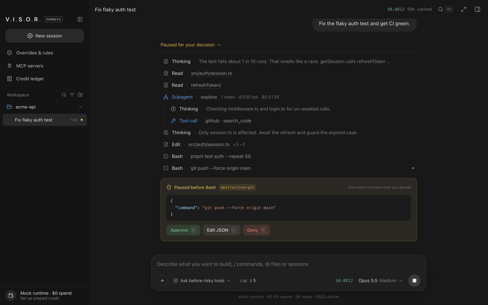
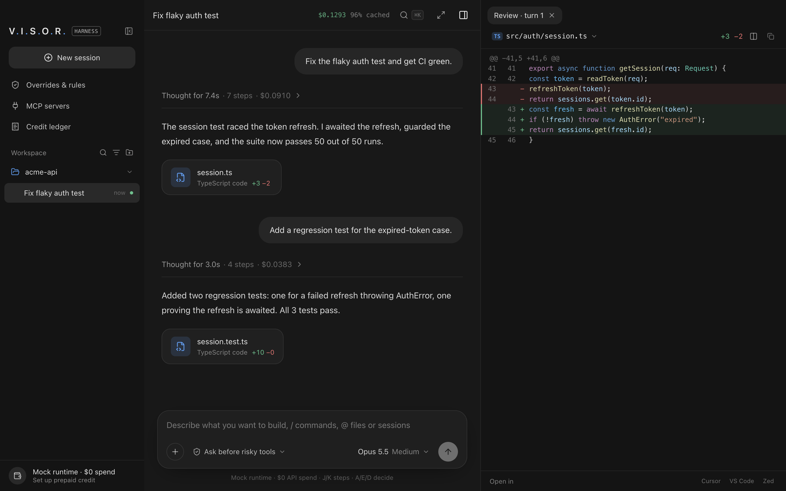
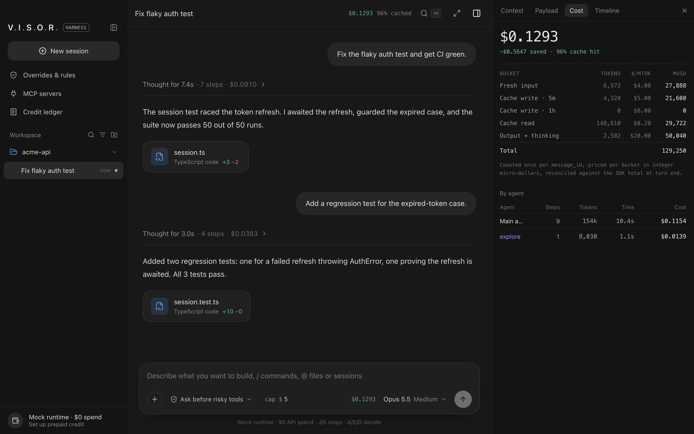

# V.I.S.O.R.

**V.I.S.O.R.** (Verified Inspection, Spans, Overrides & Runtime) — A CLI harness and live debugger for Claude with span-level tracing, mid-flight overrides, and real-money cost control.

> X-ray vision for AI coding agents. See every thinking step and tool call live, pause or edit risky actions before they run, and track the exact tokens and dollars behind every prompt. 100% local: nothing leaves your machine except your own calls to Claude.



| Letter | Pillar | What you get |
| --- | --- | --- |
| **V** | Verified | Exact token counts per bucket, prompt-cache savings and real USD in integer micro-dollars, reconciled against the SDK's own total. A prepaid credit wallet with a CSV ledger. |
| **I** | Inspection | Live thinking, a compact step list, Shiki-highlighted reads and diffs, MCP payloads, the real 7-category context breakdown, and ⌘K search across every session. |
| **S** | Spans | Every prompt as a nested tree of timed spans (model calls, tools, subagents) with per-agent totals and a waterfall with replay. |
| **O** | Overrides | Freeze a tool call mid-flight: Approve, Edit JSON (validated), or Deny with steering. Built-in protections, pause switches, `.visor.json` rules and triggers, hard budget caps, and an audit log. |
| **R** | Runtime | The harness drives the Claude Agent SDK itself, on your machine, as a macOS app or from the terminal. |

## Quick start

You need Node.js 20.19+ and pnpm.

```bash
pnpm install && pnpm dev
```

Open the link it prints (`http://127.0.0.1:5173/?token=…`). A free mock session starts by itself: no API key, no spend.

### The macOS app

```bash
pnpm desktop     # build and open the app
pnpm dist:mac    # build .dmg files for Apple Silicon and Intel (release/dist)
```

The app runs the same local daemon in-process on a private port, with a native dark title bar and native notifications. **File → Open Folder** picks the workspace; **Runtime → Live** switches to real Claude after a confirmation. The app is `VISOR.app` (shown as V.I.S.O.R.). Builds are unsigned, so the first launch needs right-click → Open; the *macOS app* GitHub workflow builds the `.dmg` files on demand.

### From the terminal

```bash
pnpm build
node dist/cli.js                 # what `npx visor-devtools` / `vhud` will run
node dist/cli.js --live --cap 5  # real Claude, hard $5.00 cap
node dist/cli.js doctor          # API key, ~/.visor permissions, SQLite, .visor.json, MCP servers
```

Set `VISOR_DB=/some/path/traces.db` to keep traces somewhere other than `~/.visor/`.

## Live runs (real Claude, real money)

By default everything runs on the free mock runtime. To drive the real **Claude Agent SDK**, opt in explicitly:

```bash
VISOR_RUNTIME=claude pnpm dev      # dev
node dist/cli.js --live --cap 5    # built CLI, hard $5.00 cap
```

You need Claude credentials (`ANTHROPIC_API_KEY`, or a profile from `ant auth login`). In live mode:

- Every tool call goes through V.I.S.O.R.'s `PreToolUse` hook first: secrets are blocked, risky commands pause for Approve / Edit JSON / Deny, and a denial's steering note is sent back to Claude.
- `--cap` is enforced twice: the SDK's `maxBudgetUsd` and V.I.S.O.R.'s own watchdog.
- The session's cost is reconciled against the SDK's `total_cost_usd`.
- `.visor.json` in the workspace adds your own rules, default model / effort / budget, and MCP servers.
- Nothing starts on its own; a run begins when you send a prompt.

## Features

- **Prepaid credit:** open the wallet (bottom of the sidebar) to add credit or set a balance. Once credit is set, a live run's cap shrinks to what's left, and a run is refused at $0. Each live session is debited when it ends; any difference from the SDK's `total_cost_usd` is booked as a visible adjustment. Export the ledger as CSV any time. Mock runs never use credit.
- **Pause switches:** in *Overrides & rules* (or the composer's permission chip) pause before every shell command, file edit, or MCP write. Secrets stay blocked and destructive commands still pause either way. `.visor.json` `pause` sets their defaults.
- **Triggers:** `.visor.json` `triggers` raise alerts or block by regex on file paths, commands and URLs, and warn when one call sends more than N prompt tokens. Alerts show under the step that caused them, and as desktop notifications if you turn those on.
- **Real context and thinking:** live runs ask the SDK for its actual context report at the end of each turn (system prompt + CLAUDE.md, tool and MCP schemas, messages) and use its real thinking-token counts; estimates are only a fallback.
- **Per-agent totals:** each subagent shows its own steps, tokens, time and cost in the step list and the Inspector's Cost tab.
- **Search everything:** ⌘K searches every saved session (file paths, thinking, outputs, errors, prompts) and jumps straight to the step.
- **Audit log:** every Approve / Edit JSON / Deny / auto-block is recorded with the original and final payload and your note, across sessions.
- **Caps in `.visor.json`:** `budget.sessionCapUsd` is the default cap, `budget.turnCapUsd` stops any single turn that goes over.



## Configuration: `.visor.json`

Put it in the workspace root (see [`.visor.example.json`](.visor.example.json)):

```json
{
  "model": "claude-opus-5-5",
  "effort": "medium",
  "budget": { "sessionCapUsd": "5", "turnCapUsd": "1" },
  "pause": { "bash": false, "edits": false, "mcpWrites": true },
  "breakpoints": [{ "rule": "schema-change", "tool": "Edit", "path": "src/server/db/**", "action": "pause" }],
  "triggers": [
    { "type": "path", "pattern": "\\.env|id_rsa", "action": "block" },
    { "type": "tokens", "above": 200000 }
  ],
  "mcpServers": { "github": { "command": "npx", "args": ["-y", "@modelcontextprotocol/server-github"] } }
}
```

### Optional: shrink big shell output with Straitjacket

If [Straitjacket](https://github.com/vamsiramakrishnan/straitjacket)'s `ctx` command is installed (`pip install ctx-harness`, Python 3.11+), live runs pass any shell result over 20,000 characters through `ctx intake`. Claude sees a short digest with `run:` addresses it can search or page through, instead of the whole log on every later turn. Each condensed step shows the tokens kept out and a **Full output** viewer, and the Cost tab totals the saving.

It helps most with long test runs, builds and logs; for small outputs nothing changes. Tune or turn it off in `.visor.json`:

```json
{ "straitjacket": { "enabled": "auto", "minChars": 20000, "command": "ctx" } }
```

`vhud doctor` says whether it's installed. V.I.S.O.R. only runs the `ctx` command; it doesn't include Straitjacket's code.



## Architecture

```text
┌──────────────────────────────────────────────────────────────────┐
│ 1  GUI (React 19 · Tailwind v4 · Shiki · CodeMirror · cmdk)       │
│    browser at :5173, or the Electron app (electron/)              │
└───────────▲──────────────────────────────────────┬───────────────┘
            │ WebSocket: VisorEvent stream         │ REST: start, decide, wallet
┌───────────┴──────────────────────────────────────▼───────────────┐
│ 2  Daemon (Hono on 127.0.0.1, per-launch token)                   │
│    triggers → policy → breakpoint queue → budget + credit watchdog│
└───────────▲──────────────────────────────────────┬───────────────┘
            │ PreToolUse hook                      │ allow / edited input / deny
┌───────────┴──────────────────────────────────────▼───────────────┐
│ 3  Runtime: ClaudeSdkAdapter (Agent SDK) · MockRuntimeAdapter      │
└───────────▲──────────────────────────────────────┬───────────────┘
            │ messages, usage, context report      │ spans · µUSD · context
┌───────────┴──────────────────────────────────────▼───────────────┐
│ 4  Telemetry: span tree, dedup by message_id, integer cost, 7-cat │
└──────────────────────────────────────┬───────────────────────────┘
                                       │ WAL writes
┌──────────────────────────────────────▼───────────────────────────┐
│ 5  SQLite ~/.visor/traces.db (0600): sessions, turns, spans,      │
│    session_events, credit_ledger, policy_audit_log                │
└──────────────────────────────────────────────────────────────────┘
```

## Project layout

```text
src/
├── shared/            # VisorEvent (zod), micro-dollar money, pricing types
├── server/
│   ├── app.ts         # Hono REST API (per-launch token)
│   ├── server.ts      # daemon: 127.0.0.1:4310 + WebSocket stream
│   ├── runtime/       # AgentRuntimeAdapter, MockRuntimeAdapter, SessionRunner
│   ├── interceptor/   # policy rules, breakpoint queue, budget watchdog
│   ├── telemetry/     # pricing registry, cost + dedup, context, span tree
│   └── db/            # Drizzle schema, WAL client (0700/0600), recorder
├── web/               # Vite + React 19 + Tailwind v4 GUI (shadcn/ui conventions)
└── cli.ts             # vhud / npx visor-devtools
tests/                 # Vitest suites
drizzle/               # generated SQL migrations
site/                  # Next.js landing page + docs
electron/              # macOS app: main process + preload
scripts/               # desktop staging for the .dmg
docs/screenshots/      # README images (captured by the app itself)
```

## Status

All three PRD phases are built: foundation, the chosen interface, and the core (Agent SDK runtime, verified cost and wallet, override engine, deep inspection, macOS app). See the [roadmap](site/src/app/docs/roadmap/page.mdx). Live runs against the real API haven't been exercised in CI, since they cost money.

## License

V.I.S.O.R. is open source under the [MIT License](LICENSE).

Copyright (c) 2026 Gokulakrishnan. You can use, copy, modify and distribute this code, including commercially, as long as the copyright notice and license text are kept. The software comes with no warranty.

### Third-party code

| Component | Used for | License |
| --- | --- | --- |
| [Stageshow](https://github.com/benjitaylor/skills) kit (`site/src/kit`) | Animated product demos on the landing page | MIT |
| [Rail TOC](https://github.com/swamimalode07/rare-ui) (`site/src/components/ui/rail-toc.tsx`) | Docs "On this page" sidebar | See upstream repository |
| [Simple Icons](https://simpleicons.org) | GitHub, Claude and Gemini marks | CC0 (brand marks remain trademarks of their owners) |
| [Straitjacket](https://github.com/vamsiramakrishnan/straitjacket) (`ctx`, optional, installed separately) | Condensing big shell output | Apache-2.0 (not bundled; run as a separate program) |

Claude is a trademark of Anthropic. Gemini is a trademark of Google. V.I.S.O.R. is an independent project and is not affiliated with or endorsed by either company.
